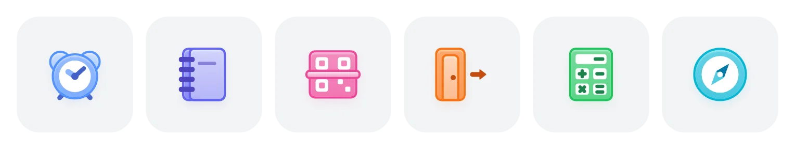

<p align="center">
  
</p>

<h1 align="center">Kubai Icons</h1>

<p align="center">
  <strong>An agent skill that draws animated icons in one consistent style.</strong><br />
  Plus 2,800+ open-source icons drawn with it, for React, Vue and the web.
</p>

<p align="center">
  <a href="#install-the-skill">Install the skill</a> ·
  <a href="https://icons.kubai.design/icons/">Browse the icons</a> ·
  <a href="#use-the-icons">Use them in code</a> ·
  <a href="https://icons.kubai.design/docs/">Docs</a>
</p>

<p align="center">
  
</p>

## What's included

| Part | What you get |
| --- | --- |
| **Agent skill** | The rules, engine and self-check that draw every icon in one hand. Give Claude Code, Codex or another coding agent a product, and it draws the icons that product needs. |
| **Icon library** | 2,800+ icons: nearly 900 objects, plus badged and slashed "off" versions. For React, Vue, plain JavaScript, web components and static SVG. MIT licensed. |
| **Website** | [icons.kubai.design](https://icons.kubai.design/), in 16 languages. Search every icon by name, shape or meaning, recolor it, copy its code or a prompt for your agent, download it as SVG or PNG, and save a collection as a ZIP. |

## Install the skill

Copy this into your agent and send it:

```text
Install the Kubai Icons skill for me:
clone https://github.com/kubai087/kubai-icons into your skills folder as kubai-icons
(~/.claude/skills in Claude Code, ~/.agents/skills in Codex;
if it's already there, pull the latest version instead),
make sure SKILL.md exists in that folder, and tell me when it's ready.
```

Restart your agent, and the skill is ready. An agent without skill support can read `SKILL.md` from the cloned folder and follow it.

> [!TIP]
> The skill asks for careful geometry and several rounds of looking at its own screenshots, so use a capable model that can read images. It was developed and blind-tested with **Claude Opus 5.5**, which we recommend. Other models, such as GPT in Codex, can use the same skill. In Claude Code, run `claude --model claude-opus-5-5`.

<details>
<summary><strong>Install it yourself</strong></summary>

<br />

Clone the repository into your skills folder. In Codex, use `~/.agents/skills` instead.

```bash
git clone https://github.com/kubai087/kubai-icons.git ~/.claude/skills/kubai-icons
```

Or download `kubai-icons-v*.zip` from the [latest release](https://github.com/kubai087/kubai-icons/releases/latest) and unzip it there:

```bash
unzip kubai-icons-v*.zip -d ~/.claude/skills/
```

The agent picks the skill up the next time it starts.

Publishing to a skill marketplace that asks for a version and display names in `SKILL.md`? Upload `kubai-icons-v*-platform.zip` from the same release. It carries those fields at the top of the frontmatter.

</details>

## Ask for icons

Describe what you need in plain words. The skill triggers on requests about icons, so you don't need to name it.

- "Read this repository and draw dynamic icons for its main features."
- "Add a scissors icon and a map icon to this set."
- "We need an icon for Export that matches the others."
- "Give me static SVG files I can drop into Figma."

The agent then:

1. Reads the rules and writes one line per feature: an everyday object and what it does on hover ("a folder opens", "a lock springs open").
2. Draws each icon after the closest existing one, reusing the engine.
3. Runs the self-check beside existing icons, compares sizes, outlines, layers and colors, and repeats until every item on the checklist passes.

To start a set for your own product, the skill copies the engine, gallery and self-check into your project and works there.

<p align="center">
  
</p>

<p align="center"><sub>Drawn by a fresh Claude session that had nothing but <code>SKILL.md</code> and <code>PROMPT.md</code>. Each blind test closes the gaps it finds in the rules.</sub></p>

## Use the icons

| Package | For |
| --- | --- |
| [`kubai-icons-react`](packages/react) | React 18+ and Next.js, server rendering included |
| [`kubai-icons-vue`](packages/vue) | Vue 3 and Nuxt |
| [`kubai-icons`](packages/core) | Any page: a framework-free API and the `<kubai-icon>` web component |
| [`kubai-icons-static`](packages/static) | Standalone SVG files for ``, design tools, native apps and CDNs |

```bash
npm i kubai-icons-react
```

```tsx
import { Folder, CalendarCheck } from "kubai-icons-react";

// 24px, follows the text color
<Folder />

// Any CSS color, the soft look, a green badge
<CalendarCheck size={32} color="#22C55E" variant="soft" badgeColor="semantic" />

// Plays when the button is hovered
<button data-kubai-trigger>
  <Folder size={18} trigger="parent" /> Open
</button>
```

No build step? One script tag loads any icon on demand:

```html
<script type="module" src="https://cdn.jsdelivr.net/npm/kubai-icons@0/dist/cdn/element.js"></script>
<kubai-icon name="folder-plus" size="32" color="#6366F1"></kubai-icon>
```

- **Moves like the object.** A folder opens, an envelope unseals, a calendar turns to the next day. Hover, focus, a tap, a parent element or your own state can play it.
- **One accent, every color.** Gradients, outlines, marks and shadows derive from one color through CSS, so icons follow `currentColor` and recolor without script.
- **Pay for what you use.** One side-effect-free ES module per icon, pre-rendered markup, server rendering, and a tiny runtime that only runs while an icon moves.

Find an icon and copy its code on the [website](https://icons.kubai.design/icons/). Guides for every package are in the [documentation](https://icons.kubai.design/docs/).

## How an icon is built

Every icon is a back piece, optional white content and a front piece, like a folder holding a sheet of paper. Outlines sit outside the fill, so shapes keep their full size. Every gradient, outline and shadow derives from one accent color, so a single value repaints the whole icon. Each part has exactly two keyframes, rest and hover.

<p align="center">
  
</p>

The complete rules are in [`PROMPT.md`](PROMPT.md).

## Reference

<details>
<summary><strong>What the skill ships</strong></summary>

<br />

| Part | What it does for the model |
| --- | --- |
| [`PROMPT.md`](PROMPT.md) | The rules, each one a hard requirement: canvas and keylines, layers, corners and outlines, light, color, marks and motion. |
| [`src/engine.js`](src/engine.js) | Color derivation, outside outlines, gradients, shadows, interpolation and palettes, already built. New icons reuse them instead of reinventing them. |
| [`src/icons.js`](src/icons.js) | 66 worked examples. Each new icon starts from the closest one in structure. |
| [`scripts/check.mjs`](scripts/check.mjs) | A headless self-check: rest, hover, every moment in between, 24px, 28px and every palette. |

`index.html` opens a local gallery of these 66 examples. The full library is on the [website](https://icons.kubai.design/icons/).

</details>

<details>
<summary><strong>Export static SVG</strong></summary>

<br />

This exports the skill's own icons, whose names and palettes are in Chinese. For the library, download from the [website](https://icons.kubai.design/icons/) or use [`kubai-icons-static`](packages/static).

```bash
node scripts/export.mjs --only 文件夹,日历 --palette 薄荷 --out icons/
```

| Option | What it does |
| --- | --- |
| `--palette` | 彩色 (default), 蓝灰, 青瓷, 薄荷, 薰衣草, 杏色 or 黑色. |
| `--accent #hex` | Paints every icon in one accent color. |
| `--state hover` | Exports the end of the hover instead of the rest pose. |
| `--size 96` | Width and height in pixels. |
| `--pad 2.5` | Room around the canvas, in icon units, so the shadow isn't cut off. |
| `--out dir` | Where the files go; `export/` by default. |

</details>

<details>
<summary><strong>Run the self-check</strong></summary>

<br />

Needs Node.js 18 or later and Chrome. Everything runs headless.

```bash
node scripts/check.mjs --only 剪刀,地图 --with 文件夹,邮件,下载
```

| Option | What it does |
| --- | --- |
| `--only` | Checks only these icons. Without it, the whole set. |
| `--with` | Adds existing icons beside them for comparison. |
| `--accent #F59E0B` | Paints every icon in one accent color, to check marks on light accents. |
| `--scale 3` | Renders every sheet at 3×, to look for seams. |
| `--out dir` | Writes the screenshots somewhere other than `check-out/`. |

`CHROME` overrides the browser path. The animations in this README come from `node scripts/media.mjs`, which also needs `ffmpeg` and `img2webp`.

</details>

<details>
<summary><strong>Work on the library and website</strong></summary>

<br />

Needs Node.js 20 or later; the contact sheets also need Chrome.

```bash
npm install
npm run build        # every package, from icons/ and badges/
npm run validate     # names, metadata and markup of every icon
npm test
node tools/check.mjs --only folder,mail --with download   # contact sheets in check-out/lib
npm run site:dev     # the website
```

Each icon is one module in [`icons/`](icons); [`docs/authoring.md`](docs/authoring.md) explains the format. The website is a static Next.js export in [`site/`](site).

</details>

## Contributing

- **Improve the skill.** Report a rule that left you guessing, run a blind test with a fresh session, or fix a script. Rule changes start from an issue.
- **Add an icon.** Draw it with the skill or by hand as a module in `icons/`, check it with `tools/check.mjs`, and open a pull request. Merged icons are credited to you on the website.
- **Submit an icon without a pull request.** The [submission page](https://icons.kubai.design/icons/submit/) checks your files and prepares an issue.
- **Request an icon.** Open an [icon request](https://github.com/kubai087/kubai-icons/issues/new?template=icon-request.yml) with the object and what it should do on hover.

See [CONTRIBUTING.md](CONTRIBUTING.md) and the [code of conduct](CODE_OF_CONDUCT.md). Security issues go through [SECURITY.md](SECURITY.md).

## License

| Part | License | In short |
| --- | --- | --- |
| Icons (`icons/`, `badges/`) and the four packages | [MIT](LICENSE-ICONS) | Use, change and redistribute them in any project, commercial or not. |
| The skill | [Kubai Icons License](LICENSE) | Source-available. See below. |
| Website (`site/`, `tools/`, `tests/`, `docs/`) | [All rights reserved](LICENSE-SITE) | You may read the source and run it to prepare a contribution, but not copy or host it. |

Under the Kubai Icons License:

- **Your icons are yours.** Icons you make with the skill belong to you, for any use including commercial, with no credit required.
- **Ship the engine with them.** You may copy the engine, the gallery, the example icons and the self-check into your own icon set's project, change them, and ship that project, as long as the copyright notice at the top of each file stays.
- **Use and share the skill freely.** You may run it for any work, change it for your own use, and share exact, unmodified copies for free.
- **Don't republish it as something else.** Don't distribute a modified or translated version of the rules (`PROMPT.md`, `SKILL.md`), sell the skill, remove its notices, or present it under another name or as your own work.

[LICENSING.md](LICENSING.md) lists which file falls under which license. The Kubai and Lumno names and logos are not licensed for reuse. The construction comes from the bookmark folder icon in [Lumno](https://github.com/kubai087/lumno-extension).
